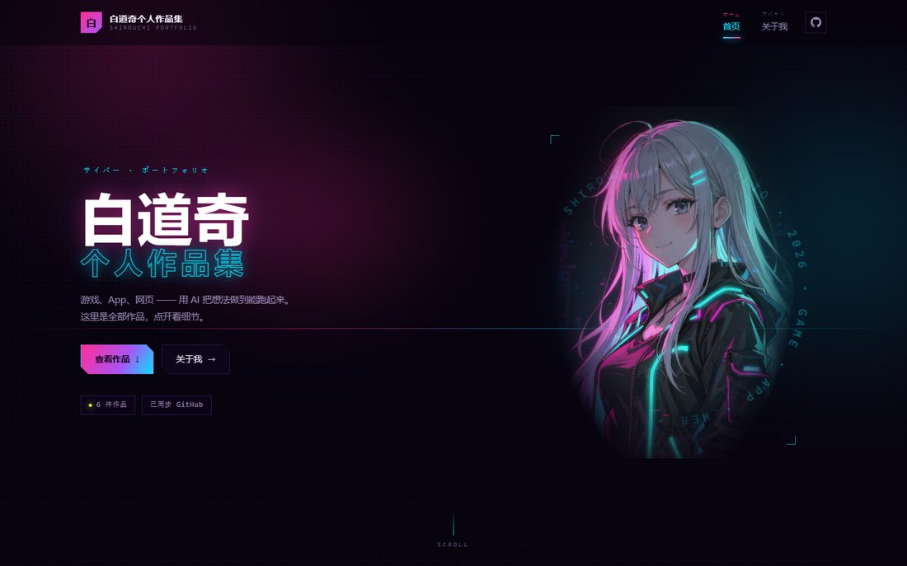
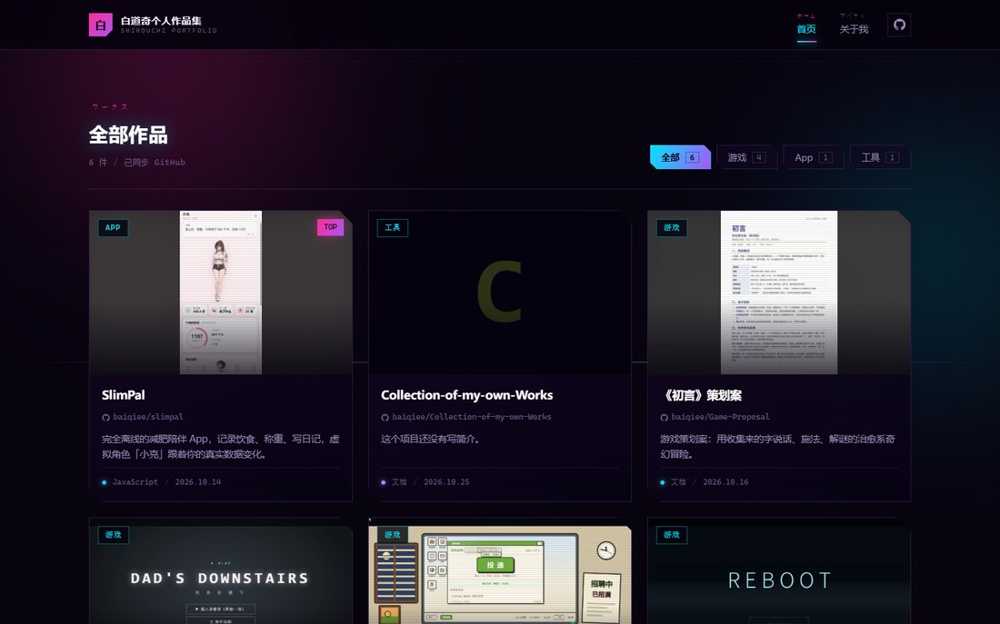

# 白道奇个人作品集

> 赛博朋克霓虹风格的个人作品集 · 纯前端 · 数据实时同步自 GitHub

**🔗 在线访问：<https://baiqiee-portfolio.app.workbuddy.host/?sharecode=FAMTISQDNX>**



## 这是什么

一个单页作品集网站，把我的 GitHub 仓库自动变成可浏览的作品墙。打开就是首页，卡片点进去是项目详情页，里面直接把仓库的 README 渲染成排版页面，有在线试玩的项目会多一个播放键。

不需要后端、不需要构建、不需要数据库——一个静态目录，丢到任何静态托管上都能跑。

## 功能

**开场**
- 全屏赛博朋克**虚拟全息投影**滤镜：扫描线、投影光锥、RGB 边缘分离、投影仪式抖动闪烁
- 停留 1.5 秒后连闪两下 —— 不是白屏爆闪，而是《2077》logo 那种**数码闪化**（RGB 通道撕开 + 逐帧跳位 + 信号条撕裂）
- **闪完第二下立刻硬切首页**，没有淡出，中间不留黑场或白场

**页面**
- 首页 Hero：大标题、片假名环、赛博朋克插画、作品数与同步状态
- 作品区：分类筛选（全部 / 游戏 / App / 网页 / 工具），切换时 FLIP 重排动画
- 项目详情：截图大图 + 简介 + `▶ 在线试玩` + GitHub 仓库 + README 排版正文
- 关于我：独立 Hero、插画视差、滚动进度条、技能条横向随滚动位移、面板渐显

**自动同步**
- 每个作品出现在页面上时，自动读取它 GitHub README 的**第一张截图**当封面、**第一段正文**当简介
- 徽章（shields 之类）自动跳过，优先用静态截图，只有动图时才退而用 gif
- 结果缓存 24 小时，过期自动重抓；想锁死某个项目的手挑封面，在 `meta` 里给它加 `autoCover: false`

**细节**
- 五块彩色幕布的交叠转场（关于页是百叶窗式，配色反转）
- 作品卡片封面用仓库里的真实截图，竖图自动加暗色模糊底衬、不裁切内容
- 全站响应式，桌面三列 / 平板两列 / 手机单列
- 尊重 `prefers-reduced-motion`



## 技术栈

| 项 | 方案 |
|---|---|
| 结构 | 原生 HTML + CSS + JavaScript，无框架、无构建步骤 |
| 路由 | hash 路由（`#/`、`#/p/<仓库名>`、`#/about`），由 JS 驱动 |
| Markdown | [marked](https://github.com/markedjs/marked) 本地引入，不依赖 CDN |
| 数据 | GitHub REST API + localStorage 缓存 + 内置快照兜底 |
| 动效 | CSS 动画、Web Animations API（FLIP）、IntersectionObserver、requestAnimationFrame |

## 目录结构

```
.
├─ index.html            页面结构（Splash / 幕布 / 三个视图）
├─ styles.css            主题、动效、响应式
├─ app.js                路由、转场、数据拉取、封面生成、README 渲染
├─ data/config.js        ★ 主要改这里：分类、简介、试玩地址、快照（封面和简介默认由 README 自动抓取）
├─ assets/
│  ├─ covers/            项目截图（卡片封面 + 详情页大图）
│  ├─ art/               赛博朋克插画（WebP）
│  └─ vendor/            marked.min.js
├─ docs/                 README 用的预览图
└─ 产品结构.md            完整的产品结构与规则说明
```

## 本地运行

```bash
python -m http.server 5173
# 打开 http://127.0.0.1:5173
```

直接双击 `index.html` 也能看首页，但浏览器会拦截本地文件的跨域请求，此时走内置快照数据；详情页的 README 需要本地服务才能加载。

## 数据是怎么来的

1. 首屏立刻用内置快照渲染，不等网络
2. 同时请求 `api.github.com/users/baiqiee/repos`（6 秒超时）
3. 成功 → 写入 localStorage（10 分钟）→ 用实时数据替换卡片
4. 失败或超时 → 保持快照，标题下提示「离线数据」
5. 详情页单独请求 README（`main` → `master` 兜底，6 秒超时），缓存 30 分钟
6. 每张卡片的封面和简介，直接从对应仓库的 README 里解析（`raw.githubusercontent.com`，不走 API，不占限流额度），结果缓存 24 小时

> GitHub 匿名接口限制 60 次/小时/IP，所以缓存和快照是必需的。想让页面永远显示最新仓库，可以定期更新 `data/config.js` 里的 `snapshot`。

## 想改成自己的

所有可配置项都在 `data/config.js`：

| 想改什么 | 改哪个字段 |
|---|---|
| GitHub 用户名 | `owner` |
| 项目展示名 / 分类 / 置顶 | `meta` 里对应仓库名 |
| 卡片封面截图 | 默认抓 README 首图；想手挑就在 `meta.<仓库名>.cover` 写路径并加 `autoCover: false` |
| 卡片简介 | 默认抓 README 首段；想手写就加 `autoCover: false` 再用 `meta.<仓库名>.desc` |
| 在线试玩地址 | `meta.<仓库名>.demo`，留空则不显示播放键 |
| 分类与关键词规则 | `categories`、`rules` |
| 技能标签 | `skills` |
| 邮箱、GitHub | `email`、`github` |
| 自动抓取开关 | 全局 `autoCover: false` |

换封面截图：图片放进 `assets/covers/`，在 `meta` 里写相对路径即可，建议 16:10 或 16:9、宽度 1200px 左右。

## 已知限制

- GitHub 匿名接口会限流，此时页面显示内置快照数据（内容不会缺，只是可能不是最新）
- 插画由 AI 生成，换形象需要重新生成 `assets/art/` 下两张图
- 没有在线试玩的项目，详情页不显示播放键

---

© 2026 白道奇 · 邮箱 b18582505605@gmail.com
